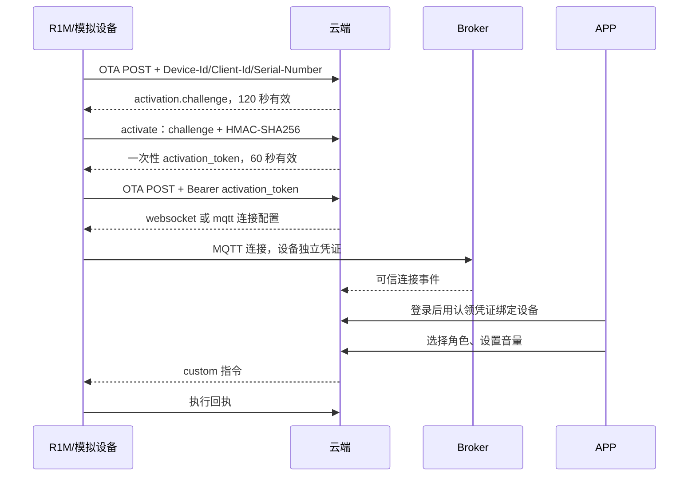

# 公司 R1M 联调协议提案 v1

日期：2026-10-09。版本：`company-r1m-proposal-v1`。

这是一版我方先定义、已经配套实现的对接契约，供合作方评审和移植。承接对方已有 OTA、MQTT hello、Opus、custom 结构；新增字段与 UDP 校验规则明确列在下文。它不是对方现固件协议已经兼容的证明，也不需要等待对方才能继续我方开发。

本轮实现支持 WebSocket 和 MQTT/UDP 两种 OTA 策略、开发 HMAC 激活、账号认领、音量指令及语音会话。后端和 APP 共用业务服务，设备连接差异留在适配器中。生产出厂验证资料可替换测试密钥，UDP 编解码可单独替换。

## 1. 启动、激活、认领



OTA：`POST /v1/partner/r1m/ota`；激活：`POST /v1/partner/r1m/ota/activate`。header 使用 `Device-Id`（冒号 STA MAC）、`Client-Id`（登记 UUID）、`Serial-Number`、`Activation-Version: 2`。body 系统身份与 header 和登记身份一致。

开发模拟器登记的 `serialNumber` / `activationKeyHex` 在私有 `.data/r1m-devices.json`，每台设备独立随机测试密钥；没有向开发板写入 eFuse。生产替换为出厂验证服务或可信密钥管理，不分发这些测试密钥。

计算：`hmac = hex(HMAC-SHA256(deviceKey, UTF8(challenge)))`；hex 大小写均可。请求 body：

```json
{"algorithm":"hmac-sha256","serial_number":"<登记序列号>","challenge":"<OTA 原文>","hmac":"<64 位 hex>"}
```

challenge 随机生成，120 秒到期；同一有效 challenge 的错误证明最多允许 5 次；成功后立即销毁，不接受重放。激活响应新增 `activation_token`，是随机、不透明、60 秒内一次性使用的 OTA 票据。后续 OTA 放在 Authorization Bearer 中，领到配置后票据消耗；没有票据时重新挑战。**这是新增约定**：不能把设备“曾经激活”作为公开 MAC/UUID 请求连接密码的永久授权。

通道凭证有效期 6 小时，重新 OTA 轮换；API 重启会清理内存票据与连接凭证，设备需重新走启动流程。本地 Broker 验证 MQTT CONNECT / publish / subscribe 的当前凭证；无效凭证不能继续上报。生产凭证持久化、多实例服务和 TLS 部署另行落实。

账号认领独立于设备激活：登录 APP 后校验一机一认领码和完整 STA MAC；Wi-Fi 通过 BLE 配网，4G/已联网可直接认领。BLE FF01 不放用户 token 或改变对方 JSON 格式。当前 APP 支持手填认领资料，相机扫码待补。

## 2. OTA 通道和 MQTT 主题

每台设备登记一个 `transport=websocket|mqtt`；由 OTA 决定，不由 APP 根据 Wi-Fi/4G 猜测。MQTT OTA 示例（密钥全部为占位符）：

```json
{
  "server_time":{"timestamp":1791540000000,"timezone_offset":480},
  "mqtt":{
    "endpoint":"broker.example:8883",
    "client_id":"r1m-020000000004",
    "username":"020000000004",
    "password":"<设备独立通道凭证>",
    "keepalive":240,
    "publish_topic":"shouban/r1m/v1/devices/020000000004/up"
  },
  "integration":{
    "contract":"company-r1m-proposal-v1",
    "udp_profile":"company-udp-ctr-hmac-v1",
    "mqtt_transport":"tls"
  }
}
```

`integration` 是新增字段，用于明确采用我方提案；本地隔离 Broker 使用 tcp，生产配置 tls。当前模拟器严格校验 profile，不将参考 UDP 格式混入这条链路。

| 身份 | 发布 | 订阅 |
|---|---|---|
| 设备 `<mac12>` | `shouban/r1m/v1/devices/<mac12>/up` | `shouban/r1m/v1/devices/<mac12>/down` |
| 云端 | 已登记设备的 down | `shouban/r1m/v1/devices/+/up` |
| Broker | `shouban/r1m/v1/broker/devices/<mac12>/presence` | 无 |
| 云端连接观察器 | 无 | `shouban/r1m/v1/broker/devices/+/presence` |

mac12 为去掉冒号的小写 STA MAC。**下行规则：把 publish_topic 最后的 `/up` 换为 `/down`**；固件需要实现此订阅规则，不依赖对方 OTA 文档没有定义的 subscribe_topic。

MQTT 控制 QoS 1，不 retain；固件按 commandId 去重，不能把 QoS 1 当成只执行一次。设备不能发其他设备主题，不能订阅通配主题，也不能发布 Broker 的 presence。云端自身连接成功不代表底座在线。

Broker CONNECT 验证使用我方云端管理入口 `/v1/partner/r1m/broker/auth`，需独立 `X-Broker-Token`；测试管理凭证在私有 `.data/r1m-broker-admin`。设备不得调用或持有这个管理凭证。

## 3. hello、语音和 custom

设备发布：

```json
{"type":"hello","version":3,"transport":"udp","udp_profile":"company-udp-ctr-hmac-v1","audio_params":{"format":"opus","sample_rate":16000,"channels":1,"frame_duration":60}}
```

服务端在 down 返回：

```json
{"type":"hello","version":3,"transport":"udp","session_id":"<随机会话 ID>","udp_profile":"company-udp-ctr-hmac-v1","audio_params":{"format":"opus","sample_rate":24000,"channels":1,"frame_duration":60},"udp":{"server":"<UDP 地址>","port":18901,"key":"<16 字节 master key 的 hex>","nonce":"<16 字节 nonce 的 hex>"}}
```

version=3 是 MQTT hello，不影响已实现 WS 二进制 version=1。两条通道共用后端角色、ASR、AI、TTS 和语音轮次隔离。

此版 UDP 先完成 **manual** 录音；WS 仍支持 manual 及基于 SentenceEnd 的自动监听。UDP auto/realtime、TTS 播放中的持续双工抢话留作后续扩展，当前不默默接受后无限等待。

上行开始：`listen.start` + `mode:manual` + `audio_sequence:<这轮第一个包序号>`；发送 UDP 裸 Opus 加密包；结束：`listen.stop` + `audio_sequence:<这轮最后一个包序号>`。控制消息携带 hello 返回的 session_id。

所有包序号在**同一会话、同一方向内持续递增**，不能每轮从 1 重置。新 hello 会话生成新 key/nonce，才可重新从 1 开始。abort、新 start、角色变化和解绑丢弃旧轮次。输入约 10 秒上限，回复 60 秒上限。

MQTT 与 UDP 到达顺序不同：双方缓存提前到达的 UDP 帧；收到 stop 后有 200ms 收尾窗口。使用 audio_sequence 校验范围、去重、排序和丢包；上行缺帧则在 ASR 前报错，不能静默把不完整语音送去识别。下行 `tts.start.audio_sequence` 是首包，`tts.stop.audio_sequence` 是尾包，设备同样做收尾检查。

custom 使用前一轮的账本：

```json
{"type":"custom","session_id":"...","payload":{"cmd":"set_volume","id":"<commandId>","args":{"value":74,"revision":1},"expiresAt":1791540015000}}
```

回执可通过 WS/MQTT 的 custom 或 HTTP `deviceEventReport`：

```json
{"type":"custom","session_id":"...","payload":{"eventId":"<commandId>","type":"cmd_ack","payload":{"result":"ok","volume":74,"revision":1}}}
```

也保留 HTTP `/api/zckj/deviceCommands` 与 `/ack`。HTTP header 使用 OTA 通道 Bearer token + Device-Id/Client-Id，body.deviceId 必须匹配。执行成功和实际音量测量分开，旧 revision/过期/旧归属/跨设备回执不能覆盖新意图。

## 4. UDP 字节级契约

本版 `company-udp-ctr-hmac-v1` 在对方的 16 字节头 + AES-CTR Opus 框架上增加完整性校验。**flags=1 与末尾 16 字节 tag 是我方新增规则，需要合作方采用；不能直接假定现固件兼容。**

| 字段 | 偏移 / 长度 | 值 |
|---|---|---|
| type | 0 / 1 | `0x01` |
| flags | 1 / 1 | `0x01`：附 HMAC tag；其余位为 0 |
| payload_len | 2 / 2 | Opus 密文长度，不包括头和 tag，最大 1275 |
| SSRC | 4 / 4 | hello.nonce 的第 4–7 字节 |
| timestamp | 8 / 4 | 音频时间毫秒；当前模拟器 `(sequence-1)*60` |
| sequence | 12 / 4 | 从 1 起的无符号序号，禁止回绕 |
| ciphertext | 16 / payload_len | AES-128-CTR 加密的一个 Opus 包 |
| tag | 16+payload_len / 16 | HMAC-SHA256 的前 16 字节 |

整数使用网络大端。先校验包长、SSRC 和 tag，再解密；未验证的包不能固定 UDP 回传地址。首个校验成功包固定地址和端口；NAT 地址变化要重新创建语音会话。

每方向派生 48 字节：

```
material = HKDF-SHA256(
  IKM = hello.udp.key 的 16 字节,
  salt = hello.udp.nonce 的 16 字节,
  info = UTF8("company-udp-ctr-hmac-v1/up" 或 ".../down"),
  L = 48
)
AES key = material[0:16]
HMAC key = material[16:48]
IV = nonce[0:8] || UInt32BE(sequence) || 0x00000000
ciphertext = AES-128-CTR(AES key, IV, Opus)
tag = HMAC-SHA256(HMAC key, header || ciphertext)[0:16]
```

AES CTR 低 32 位作为块计数，packet sequence 占更高位，单包最大 1275 字节不会跨越这个计数区域。不同方向分别派生密钥。这样相邻包、同 timestamp 包、上下行和新会话不会因普通 seq+1 重用密钥流。timestamp 不作为 IV。

对方若要求 flags=0、没有 tag 的既有格式，我们另加经过测试向量校准的 codec；本版作为可运行参考，不强行让两种格式混用。

公开测试向量：[r1m-proposal-vectors.json](../config/r1m-proposal-vectors.json)。里面所有 key 都是明确的公开固定测试值，禁止作为任何设备运行密钥。包含上/下行、相同 timestamp 的多块音频、HMAC 激活结果。后端与独立设备实现均逐项校验。

## 5. 在线状态与会话寿命

| 证据 | 用途 |
|---|---|
| Broker 实际 clientReady / clientDisconnect | MQTT 网络连接，包括正常 DISCONNECT，无需假定固件配置遗嘱 |
| Broker 为每条连接生成 connectionId | 拒绝旧连接晚到的断连事件 |
| 保留的 Broker presence 快照 | 云端重订阅时恢复连接证据；设备不能伪造 |
| 云端自己的 Broker 连接丢失 | 所有 MQTT 连接证据转为未知，撤销对应语音会话 |
| hello / goodbye / idle close | 控制/语音会话的可达性，与设备网络分开 |
| HTTP 状态上报 | 对方默认关闭，本版不靠它判断 MQTT 在线 |

OTA keepalive=240。Broker MQTT 协议保活判断断连；应用不用旧 45 秒窗口，也不要求新模拟器发 5 秒业务心跳。语音空闲默认 120 秒释放，Broker 仍连接时 APP 显示“设备在线 · 语音控制通道未打开”。custom 默认待下次 hello 或用已启用的 HTTP 轮询。

## 6. 代码、运行与验证

后端：`r1m-access.service.ts`、`r1m-mqtt-voice.service.ts`、`r1m-proposal-codec.ts`。独立设备参考：`apps/device-simulator/src/r1m-mqtt.mjs`；里面独立实现 HMAC 激活与 UDP crypto，没有导入服务端 codec。

```bash
npm run dev:partner -- --voice --r1m
npm run simulate:r1m-mqtt -- --wav=/absolute/path/input.wav
npm run test:r1m
npm run test:voice
npm run test:mqtt
npm run typecheck
```

联合运行同时启动 WS、MQTT/UDP、旧参考 MQTT 及开发板联调环境。新增未绑定 R1M-MQTT-SIM；在 APP 直接认领并选择角色后使用模拟器。WAV 输入为 16kHz 单声道 PCM16，回复以 24kHz WAV 保存到私有 `.data/r1m-simulator/`。单次语音进程持短时独占锁，后台模拟器暂停重连竞争。

自动回归使用真实 MySQL/Nest/MQTT/UDP 和明确的 ASR/AI/TTS 测试替身；验证 HMAC 错误/过期/重放、一次性票据、topic ACL、Broker 正常断开、voice idle 与网络分离、加密与 tag 篡改、丢尾包和重录、custom/HTTP 共用账本，以及前一轮 WS 语音和归属隔离。

本轮检查结果：R1M 自动回归 22 项、旧 MQTT 回归 16 项、参考语音回归 9 项全部通过，后端和 APP 类型检查通过。Android 真机选择 MQTT/UDP 联调底座，音量从 60% 改为 78%，收到设备执行回执。

真实服务联调也已完成：上阶段 2.82 秒合成录音编码成 47 个加密上行帧，实际 ASR、AI 和 TTS 处理，模拟设备验证并解码 71 个下行帧。没有声称真实 4G 模组、R1M 麦克风/扬声器或合作方固件已经验收。本轮未刷写实体参考开发板，iOS 保留共享 APP 类型和状态显示，本轮未实测。

给合作方评审时，可一起提供本文、公开测试向量与独立模拟器；私有 .data、启动密钥、开发激活密钥、Broker 管理凭证和用户音频不随文档发出。

## 阶段六业务扩展

新增 `identify_device` 定位底座指令，APP、后端、WS/MQTT 模拟设备与 HTTP 补发已实现。完整字段、回执及验证见 [定位底座业务闭环](partner-phase6-business.md)。这是我方提出的业务能力，实体灯效需合作方实现。

## 阶段七主动播报

APP 主动播报、设备完成回执和停止确认已实现；新增 play_audio、stop_playback、tts.command_id 与加密 UDP peer 探测约定见 [APP 主动播报与停止播放](partner-phase7-app-speech.md)。需要合作方按真实播放生命周期实现。

## 阶段八云端提醒

新增一次性及每日云端提醒，沿用 play_audio 和既有音频协议。调度、离线不补播、编辑/暂停/删除和执行回执见 [R1M 云端定时提醒](partner-phase8-cloud-reminders.md)。本阶段不新增设备本地离线闹钟契约。
## NFC 业务扩展

账号标签映射、custom NFC 事件、会话重建与 APP 模拟操作见 [阶段九对接说明](partner-phase9-nfc.md)。这部分属于我方补充契约，需合作方参考实现。
