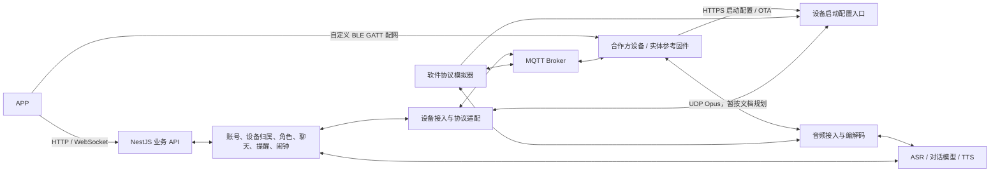

# 合作方设备接入与重构方案（讨论稿）

日期：2026-10-04

目标：公司负责 APP 与后端，适配合作方交付的设备固件；同时开发协议模拟器及可供合作方参考的设备实现。本文是架构与实施方案，不代表功能已实现或合作方已确认新增协议。

## 1. 输入、事实与边界

依据：现有 `apps/api`、`apps/mobile`、`firmware` 源码，以及合作方提供的 `cloud-api-spec-r1m.md`、`BLE配网协议对接文档.md`。

- 用户已说明合作方采用 MQTT，因此首期设备接入以 MQTT 为主。
- 合作方云端文档中的 MQTT 方案以 MQTT 承载 JSON 控制、UDP 承载加密 Opus 音频。方案暂按这一组合规划；实际音频通道仍待核实。
- 文档中的 OTA 配置入口、hello/listen/abort/stt/tts/mcp 和二进制音频结构属于已有协议描述；当前没有合作方源码、实际报文或实机验证。
- 事件上报、custom 指令及 HTTP 指令轮询包含建议和待约定项，不能视为已实现功能。
- 自定义 BLE 配网使用 FF00 服务及 FF01/FF02/FF03 特征，广播 ZAOC_ 前缀，不使用我们现有的官方 Provisioning 流程。
- HTTP 状态上报默认关闭的描述与 MQTT 保活是两件事。在线判断不能继续直接沿用旧 HTTP 心跳规则。
- 后续收到对方确认后修改本方案中的配置和扩展契约；不要求合作方接受我方旧设备协议。

## 2. 总体结构与双方职责

| 工作项 | 我方 | 合作方 | 联合验收 |
|---|---|---|---|
| APP 产品页面、账号操作 | 开发 | 提供设备操作约束 | 用户使用流程 |
| BLE 配网 | APP GATT 客户端、状态处理 | GATT 服务、Wi-Fi 连接、结果通知 | Android/iOS 实机配网 |
| 设备身份、激活、认领 | 云端登记、鉴权、账号归属 | 出厂身份/凭证、设备激活请求 | 身份一致与解绑重绑 |
| MQTT 接入 | 后端订阅/发布、Broker 接入与权限 | 连接、订阅、重连、消息执行 | 空闲及对话期间双向通信 |
| 语音 | 云端音频处理、模型、角色音色 | 采集、编码、播放、唤醒及打断 | 一轮及连续多轮对话 |
| NFC | UID 与实体手办/角色映射 | 读卡与事件上报 | 放入、移除、快速换角色 |
| 闹钟 | APP 管理、计划与铃声生成、同步状态 | 若支持离线闹钟则负责缓存及本地执行 | 缓存、响铃、停止、稍后提醒 |
| OTA | 配置入口、版本信息、下载资源 | 校验、升级、恢复机制 | 指定版本升级结果 |
| 模拟与参考代码 | 提供协议模拟器、参考实现和测试场景 | 对照实际固件修订 | 模拟器与实机行为一致性 |

Broker 归属、地址和部署方式待确认。业务服务和设备接入首期可放在同一个 NestJS 应用内，使用清晰模块边界；音频模块预留独立部署能力，不在首期强制拆成多个服务。

## 3. 后端重构

### 3.1 保留与拆分

保留现有 TypeORM 持久化、角色资料、消息记录、ASR、对话模型、TTS、铃声上传/合成等能力。

逐步拆分 `StoreService`，让业务服务通过统一设备接口交互，避免直接生成某个厂商的 wire payload：

| 模块 | 职责 |
|---|---|
| DeviceRegistry / DeviceIdentity | 设备登记、外部身份映射、凭证、固件信息与能力 |
| DeviceBinding | 用户认领、解绑、换主人、所有权校验 |
| DeviceGateway / PartnerProtocolAdapter | MQTT 订阅发布、hello、协议映射、连接与语音会话 |
| DeviceCommand / DeviceEvent | 持久指令、执行状态、事件幂等、回执及重试 |
| Conversation / VoiceSession | 每轮角色快照、上下文、ASR/LLM/TTS、取消与打断 |
| AudioTransport / AudioCodec | UDP、加解密、序号、Opus 编解码和音频缓存 |
| Alarm / Reminder | 计划、铃声、同步版本、设备能力对应的调度策略 |
| DeviceBootstrap / OTA | 系统信息请求、时间、接入配置、激活、固件资源 |

旧 HTTP/WS 设备协议在迁移期间作为独立 legacy adapter 使用；业务层不维护两套业务流程。是否最终保留旧接入由后续产品范围决定。

### 3.2 三类身份与两类会话

- 内部 `deviceId`：数据库稳定主键，APP 与业务 API 使用。
- 外部设备身份：Wi-Fi STA MAC、出厂序列号、Client UUID、旧 hardwareId 等映射到内部设备。BLE 连接句柄/手机发现 ID 不作为云端设备主键。
- 认领凭证：用于证明用户有权绑定设备，与 MAC、MQTT Client ID、对话 session_id 区分。
- MQTT 连接：用于设备控制和在线管理。
- 语音会话/对话轮次：用于音频与回复，关闭语音会话不自动等同于设备离线。

MAC 与 UUID 不是秘密。模拟环境可使用隔离的演示凭证，生产接入须按双方确定的出厂凭证或激活校验执行。

### 3.3 启动配置与绑定

目标流程：

1. 设备取得网络，向约定 HTTPS 配置入口上报系统信息。
2. 云端识别设备、按已确定的激活机制校验，返回 server_time、MQTT 连接参数及必要的固件信息。
3. 设备连接 Broker；后端建立设备连接状态。
4. APP 使用约定认领凭证绑定用户与内部 deviceId。
5. 后端按设备能力同步当前配置，允许已绑定且具备角色的设备进入相应业务。

设备登记/接入与用户认领分别建模，支持设备先联网或用户先认领。APP 必须区分“Wi-Fi 配置成功”“已连接我方云端”“账号绑定成功”。

现有 BLE 会发送后端地址到 yuzhou-config；合作方 BLE 文档没有对应字段。目标云端入口的设置方式待确认，不能继续无条件发送这个自定义 endpoint，也不能擅自往 Wi-Fi JSON 增加字段。

### 3.4 MQTT 控制与在线状态

Topic、QoS、连接凭证、TLS、上下行消息投递规则放在接入配置/适配器内。未确认的 Topic 只用于本地模拟，不硬编码为合作方正式协议。

- 上行消息统一转换为内部设备事件；Topic 权限和认证身份决定设备归属，不能只信任 payload.deviceId。
- 下行先持久化逻辑命令，再转换为合作方已有消息或双方约定扩展。
- Broker 连接/断开事件若可接入则用于在线管理；遗嘱需设备正确配置才可使用。否则使用双方约定的状态消息和超时策略。
- MQTT 保活不直接更新音量、电量、NFC 等业务状态；状态字段需设备主动上报或响应查询。
- 消息传输确认与固件执行成功区分。MQTT ACK 或 publish 成功不能直接标记业务命令完成。
- 重要命令有幂等 ID、有效期、状态和失败原因。重复投递不能重复触发响铃、播放或升级。
- retained 消息只在双方确定的“最新状态”语义中使用；临时播放、响铃、重启等一次性动作不作为 retained 消息。
- 断线恢复同步最新配置，过期动作丢弃；不盲目补播所有历史语音。
- HTTP 轮询仅在双方明确需要时实现降级；MQTT 为主时不默认保留设备轮询要求。

建议内部命令状态：pending → dispatched → succeeded/failed/expired/cancelled。需要时记录设备 received/running 回执；本地发送成功仍为 dispatched。

### 3.5 语音适配

暂按文档的 MQTT 控制 + UDP 音频实现：

1. 接收 hello，验证连接身份和能力，返回语音 session_id、音频参数及 UDP 会话配置。
2. listen.start 创建一轮对话；记录账号、角色和轮次快照，防止异步处理期间换角色串台。
3. UDP 上行校验会话、包长度和序号后解密，Opus 解码为 ASR 可用的 PCM。
4. 处理 listen.stop 和 auto/manual/realtime 对应的结束规则；不直接沿用旧 10 秒录音上限。
5. ASR 最终结果映射为 stt，消息进入现有聊天记录与角色上下文。
6. 模型流式输出进入 TTS；PCM 编码为约定 Opus 帧，配合 tts.start/sentence_start/stop 下发。
7. abort 取消本轮生成及待发音频；轮次隔离，迟到音频和文本不得进入下一轮。
8. goodbye 释放语音会话及密钥，不因此直接判定 MQTT 已断开。

listen.detect 的 text 先按合作方定义识别用途，不能默认当作用户的 ASR 最终文本。

文档中的上行 16kHz、下行 24kHz、60ms 帧长作为模拟 profile 初始值，正式 profile 以协商结果为准。UDP 包头、字节序、nonce 组装和加密范围需要源码/报文测试向量核对；描述不足时记录未验证，不能靠双方模拟器一致来证明实机兼容。

增加有界缓存、过期包处理和乱序/丢包策略；具体策略结合设备接收能力验证。APP 继续复用现有聊天流和设备语音识别订阅接口，无需承担设备 UDP 协议。

### 3.6 NFC、角色与闹钟

NFC、sync_character、sync_alarms、control_alarm 等没有完整合作方定义，属于待协商扩展。后端可先提供内部能力和模拟 profile，正式适配器仅发送已确认的协议。

- 建议将角色模板与实体手办/NFC 标签分开；多个实体手办可以对应同一个角色。
- 聊天记忆当前按用户+底座+角色隔离。首期保留这一语义，是否跨底座共享留给产品决策。
- 能力声明至少区分 NFC、远程播放、离线闹钟、闹钟缓存数量、停止/稍后提醒、睡眠控制及 OTA；未知能力不视为已支持。
- 禁止继续凭固件版本大小判断离线闹钟支持，合作方 1.0.0 与旧固件 0.8 没有可比关系。
- 支持本地闹钟时，后端下发带 revision 的快照；设备完成音频缓存和计划提交后回执，APP 才显示已同步。
- 若仅支持在线提醒，APP 明确展示依赖联网，不把它等同于离线闹钟。
- 解绑需清理云端待执行任务，并按已支持协议清除设备端旧计划。设备离线时保留待清理状态，重新认领前处理旧缓存，不能认为数据库清理会自动清空固件。

## 4. APP 改造

### 4.1 可复用部分

保留手办主页、聊天、闹钟/铃声管理及配网引导结构。设备环境与权限检测大部分可复用，但 BLE 扫描、连接、特征读写和状态通知替换为自定义 GATT 实现。

### 4.2 BLE 目标流程

1. 按 ZAOC_ 广播名称发现设备；不要求广播携带 Service UUID。
2. 连接后发现 FF00 服务和特征，注册接收处理并启用 FF01、FF03 通知，订阅完成后再发送请求。
3. 向 FF01 写入 scan，按扫描状态聚合/去重裸 SSID 通知。
4. 写入 UTF-8 JSON {ssid,password}，按实际协商 MTU 和双方确认的拼包规则处理。
5. 以 {status:"1"} 判断 Wi-Fi 成功；成功后的预期断连/重启作为正常流程。
6. {status:"0"} 保持连接并支持重试；普通断连不能直接判断成功。
7. 继续云端连接和账号认领确认；提供仅重试绑定的路径，避免反复发送 Wi-Fi 密码。

SSID 列表当前不含 RSSI、安全方式或频段，不伪造这些字段，不根据名称判定 5GHz。允许手填 SSID 和空密码；具体界面依据正式返回能力调整。

扫描完成标记、无结果、通知分片、UTF-8 字节长度、MTU、BLE 加密/配对规则属于待完善项。未确认保护机制前，不沿用“通过加密蓝牙发送”的承诺。

### 4.3 APP 接口与状态

- APP API 继续使用内部 deviceId；Broker 凭证和 UDP 密钥不进入 APP。
- 抽象 ProvisioningClient，分别提供真实合作方 BLE 实现和显式开发 mock，实现可替换。
- mock 必须在开发界面明确标记；生产流程不能静默降级成成功假数据。
- 设备设置动作显示等待设备/执行成功/失败；接口受理不直接等同设备执行成功。
- 多设备改为明确 activeDeviceId，逐步替换 devices[0]，避免绑定第二台后操作错设备。
- 根据已声明能力展示闹钟、睡眠、NFC 等功能及限制；现有本地睡眠开关需接入真实命令或标记未支持。

## 5. 模拟器与实体参考固件

### 5.1 软件协议模拟器：优先开发

现有 device-simulator.mjs 只执行旧 HTTP 心跳/拉取/ACK，不能验证合作方协议。新增独立进程模拟器，通过外部 HTTPS/MQTT/UDP 接入；不得直接调用 StoreService 或数据库来模拟通信。

能力：

- 配置多个 MAC、UUID、序列号、凭证与能力 profile。
- 模拟启动配置、激活状态、MQTT 连接/订阅、hello、listen、abort、goodbye。
- 用录音文件生成上行 Opus，接收下行 Opus 并解码成可试听音频；文字 stub 仅用于独立业务调试，不作为语音链路验收。
- 模拟 NFC 放入/移除、音量变化、指令成功/失败和真实执行延迟。
- 本地模拟闹钟计划、缓存、响铃、停止与稍后提醒；日志展示 revision 和结果。
- 注入断线重连、消息重复、乱序、超时、失败、UDP 丢包/迟到和快速打断。
- 输出脱敏 wire trace、设备状态与命令生命周期，便于与对方实机报文比较。

不要收到命令就无条件 ACK 成功。模拟器应执行相应模拟动作，并返回可核对的结果。

### 5.2 BLE 验证：单独管理

软件模拟器可模拟 APP 配网状态，不能自动验证手机真实 GATT 通信。

- APP mock 验证引导、重试和页面状态。
- 真实 BLE peripheral 参考固件/测试设备验证 Android/iOS 扫描、服务发现、CCCD、分包和通知。
- 参考设备应按文档不在广播中放 Service UUID，以覆盖当前代码的真实不兼容点。

### 5.3 ESP32 参考固件：分阶段开发

保留现有固件作为硬件驱动和已实现功能的参考，新增合作方协议 profile 或独立参考目标，不在方案阶段整体改写 board_self_test.c。

优先参考实现自定义 BLE GATT 与 MQTT 基础控制；正式音频契约明确后再加 UDP/Opus，对 NFC/闹钟扩展提供明确样例。

交付参考代码时附接口版本、能力列表、配置说明和测试报文；说明模拟 profile 与正式 profile 的差异。参考代码帮助对接，不替代合作方的驱动、量产凭证、OTA 与整机验证责任。

## 6. 实施顺序与验收

| 阶段 | 工作内容 | 验收结果 |
|---|---|---|
| 0 | 固化契约分类、配置 profile、设备能力与身份设计 | 已有/建议/待确认项可追踪 |
| 1 | 提取设备业务边界，新增 MQTT 接入与软件模拟器 | APP 设置音量→命令→模拟执行→回执→APP 状态完整可见 |
| 2 | 设备启动配置、激活/认领、在线管理、重连 | 断网、重复消息、凭证失败、解绑重绑场景通过 |
| 3 | UDP/Opus 与现有 ASR/LLM/TTS 接通 | 文件语音输入→识别→角色回复→可试听音频；多轮及打断通过 |
| 4 | APP 自定义 BLE 与实体参考 peripheral | Android/iOS 扫描、配网成功、失败重试和成功后断连通过 |
| 5 | NFC、提醒、闹钟扩展和能力驱动 UI | 仅已确认支持的功能进入正式 profile；同步回执真实可见 |
| 6 | 合作方实机替换模拟器 | 相同业务流程使用正式 profile；差异能由报文定位 |

阶段可交叉进行；BLE 测试不依赖完整语音功能。先完成可测的协议边界，再逐步迁移 StoreService，避免一次改动所有业务造成难以定位的回归。

重点验收：

- 模拟设备与后端使用独立进程和真实通道，MQTT 传输成功不冒充设备执行成功。
- 重复命令不重复执行，失效命令不在重连后补播；最新配置可以恢复。
- 换角色/解绑/打断后，旧轮次音频不进入新会话。
- Wi-Fi 成功、云端在线、账号绑定分别显示，不出现断连即成功。
- 模拟器通过仅证明与当前 profile 一致，正式兼容仍须对方实机或独立测试向量验证。

## 7. 待确认项与当前可推进工作

用户会另行向合作方确认，以下不作为反复向用户追问的阻塞：

| 待确认 | 当前处理方式 |
|---|---|
| 机型、交付固件版本、实际是否 MQTT+UDP | 以文档 MQTT+UDP 作为暂定 profile，记录未验证 |
| Broker 归属、MQTT 版本、Topic、QoS、TLS、凭证 | 本地隔离 Broker 和配置化模拟 profile；正式参数后续替换 |
| 设备下行订阅机制、空闲期控制可达性 | mock 支持常驻控制；正式接入前用实机确认 |
| 出厂登记、激活、认领、二维码 | 预留身份/认领接口；本地使用显式演示凭证 |
| 云端入口配置、HTTP 路径和激活路径拼接 | 集中 route/profile 配置，不猜测文档域名归属 |
| UDP 包头、nonce、加密范围和音频规则 | 抽象编码器，待测试向量验证；未核实不宣称兼容 |
| MCP 工具列表与具体参数 | 设备能力发现和工具适配边界；不假定已有 NFC/闹钟工具 |
| NFC、角色切换、闹钟和回执格式 | 内部业务契约先行；模拟扩展与正式扩展分开 |
| BLE 扫描结束、分包、加密和身份关联 | APP 状态抽象与参考 peripheral 可先做，约束可配置 |

接下来无需等待全部外部参数即可推进：提取设备接口、定义内部命令/事件/能力类型、设计可配置 partner profile、搭建软件模拟器基础，以及保持 APP API 稳定的模块拆分。

实际生产协议、凭证分发和新增固件能力须在收到确认后落定。当前阶段完成方案，不视为已授权部署、发给合作方或更改他们的服务。

## 8. 第一轮开工范围（2026-10-08）

### 8.1 本轮目标

建立可以独立运行和重复验收的 MQTT 设备控制链路：APP 选择模拟设备并调节音量 → 后端持久化命令 → MQTT 下发 → 模拟设备修改实际音量 → 执行回执及状态上报 → APP 显示设备结果。

选择音量作为首个场景，是因为它覆盖身份、权限、命令、上下行通信、回执和状态同步，结果容易核对，且已有 APP 操作入口。

本轮使用本地 MQTT Broker、显式标记的模拟设备、配置化的开发协议。set_volume 的正式传输方式尚未确认；先采用文档建议的 custom 思路作为模拟约定，命令 ID 与回执格式单独定义，不将其宣称为合作方已经实现的协议。

### 8.2 七项工作

1. 建立项目 Git 基线与隔离的联调数据库配置，安装依赖，验证现有 API 构建和 APP 类型检查；存在失败先记录并处理与本轮有关的项。不要从复制来的旧数据自动推断设备支持新协议。
2. 定义 DeviceAdapter、内部设备事件/命令、设备身份映射、能力与接入 profile。保留 legacy 接入，逐步提取设备边界，不一次拆完 StoreService。
3. 增加命令生命周期、执行失败原因、超时、幂等与数据库变更方案。区分期望音量和设备上报音量；当前 updateVolume 在设备执行前直接保存 volume 的行为需要调整。
4. 接入本地 Broker，实现上行订阅、下行发布、连接恢复及可验证的设备在线管理。Topic、凭证、QoS 和消息映射集中配置，具备接入开关。
5. 开发独立运行的 MQTT 模拟器，提供两个设备 fixture、成功/失败/超时/重复消息/断网重连场景，以及开发 profile 的状态与遗嘱消息。正式在线事件机制待对方确认。
6. 改造 APP 的设备选择和调音量结果显示。明确 activeDeviceId，显示正在设置、设备已确认、失败及超时；期望值不能直接替代设备实际值。
7. 提供启动说明、开发协议样例、脱敏上下行日志及自动化联调场景，复核旧设备基本路径兼容性。

### 8.3 代码改动位置（建议）

| 位置 | 本轮用途 |
|---|---|
| apps/api/src/modules/device-integration/ | 新增适配接口、配置、MQTT 接入、命令派发和事件处理 |
| apps/api/src/modules/figure-companion/store.service.ts | 提取设备控制边界，调整音量与回执流程 |
| apps/api/src/modules/figure-companion/entities.ts / contracts.ts | 增加命令状态、设备身份/能力和期望/上报字段，保持迁移兼容 |
| apps/api/src/modules/figure-companion/devices.controller.ts | 保留 APP 操作入口，补齐结果查询或响应字段 |
| apps/mobile/App.tsx / src/api.ts / src/types.ts | activeDeviceId、设备选择和异步执行状态 |
| apps/device-simulator/ | 独立 MQTT 模拟器及场景脚本，必要时纳入 workspace |
| 本地联调配置与 docs/ | Broker/数据库运行说明、模拟 profile 和验收步骤 |

目录按实施时的最小改动调整，职责边界保持一致。既有命令行脚本和 legacy 设备接口在本轮保留。

### 8.4 验收条件

- 一套可复现的命令启动后端、Broker 和模拟设备，APP 能选择设备 A 或 B。
- APP 将 A 音量设置为 70，只有 A 执行；回执后 APP 显示其实际音量 70，B 保持原值。
- 模拟设备拒绝命令时，APP 显示失败及原因，实际音量仍是旧值。
- 无回执时进入超时状态；重复消息不会造成重复执行或重复结果记录。
- 模拟设备断网与重连时，状态按本地 profile 正确更新，过期命令不补执行，期望配置按约定恢复。
- API 重启后持久指令和结果可追踪，恢复派发有幂等保护。
- API 构建、API/APP 类型检查及 MQTT 核心联调场景通过；必要的既有路径回归通过。
- 文档明确区分模拟协议、合作方已描述协议、尚待确认的扩展。

### 8.5 后续轮次

第二轮：设备启动配置、正式身份/认领接入边界及 APP 自定义 BLE；配套实体 BLE 参考目标，Android/iOS 分别验收。

第三轮：按确认后的音频契约接通 MQTT 语音控制及 UDP/Opus，支持文件录音输入、可试听回复和打断。

第四轮：NFC、角色切换、提醒、离线闹钟与相关能力；继续扩展参考固件。

第五轮：替换为合作方实机/profile，核对身份、Topic、鉴权和真实报文，完成产品功能验收并整理参考代码交付包。

以上可在明确边界后交叉推进。当前只制定开工范围，尚未执行第一轮代码改造。
