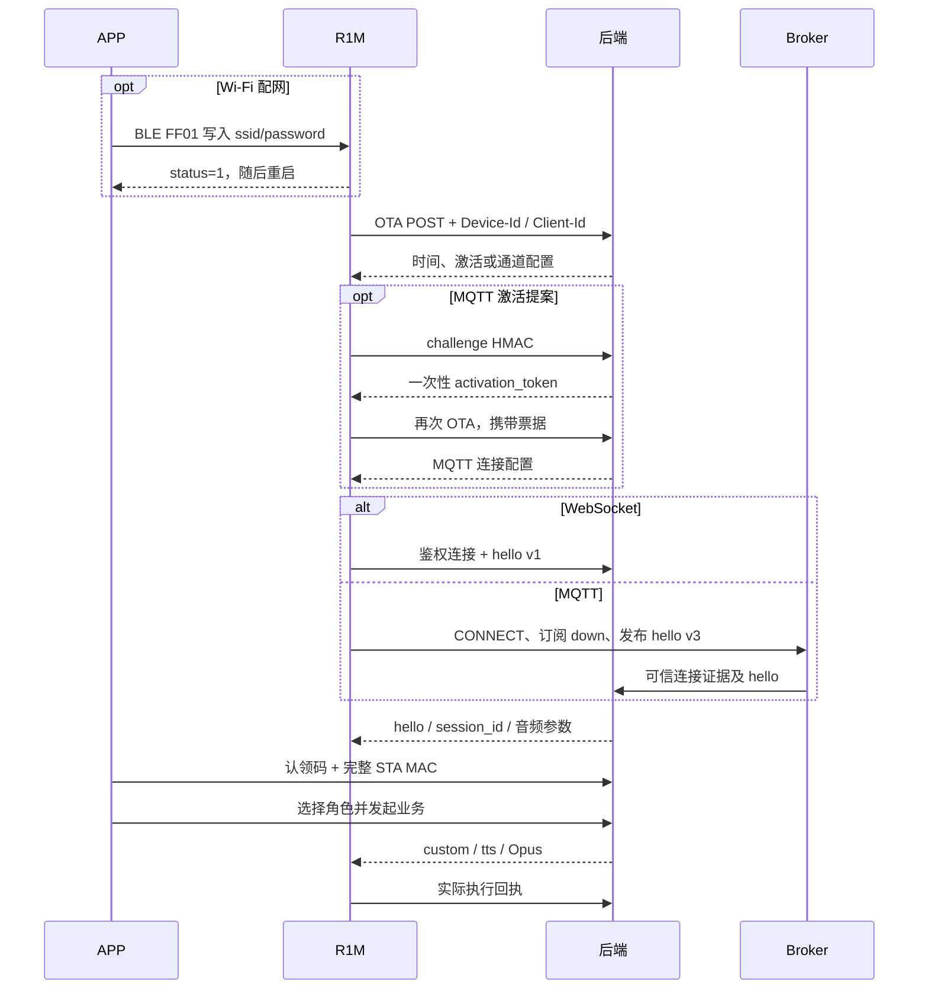

# R1M 合作方对接入口

日期：2026-10-09。契约：`company-r1m-proposal-v1`。本项目由我方负责 APP / 后端，合作方负责真实 R1M 固件与硬件。交付源码用于参考移植和共同验收；本地通过不代表对方现有固件已兼容。

## 从哪里开始

1. 阅读本文，双方核对下表中“我方补充”的约定。
2. 按 [模拟器说明](../apps/device-simulator/README.md) 启动本地环境，观察 OTA、hello、custom 和回执。
3. 执行 `npm run accept:partner`，查看自动验收报告；按 [硬件验收清单](partner-acceptance.md) 接入真实设备。
4. 出现差异时记录消息方向、类型、时间、事件/指令 ID 和固件版本；用相同场景在参考模拟器复现，再调整适配器或固件。

## 协议来源和实施责任

合作方已提供 `cloud-api-spec-r1m.md`、`BLE配网协议对接文档.md`。原文作为协议输入，仍以双方持有的原文件为准；本文没有替合作方改写原文。以下为现阶段采用范围：

| 能力 | 来源 | 当前落地与合作方实施点 |
| --- | --- | --- |
| BLE Wi-Fi | 合作方文档 | 保持 FF00 / FF01 / FF03、ZAOC_ 名称、UTF-8 JSON 和原通知格式；固件实现真实扫描、连接与结果通知 |
| OTA / 校时 | 合作方文档 | 设备启动 POST 系统信息；云端返回时间和单一语音通道配置 |
| WS 音频 | 文档支持多个版本；用户确认采用 v1 | 当前裸 Opus，无额外二进制头；固件协商采样率和帧时长 |
| MQTT 控制 + UDP 音频 | 合作方文档 | MQTT hello v3、UDP AES-CTR 框架；下列完整性扩展需单独采用 |
| 激活 HMAC | 合作方文档已有 challenge / HMAC | 本地每设备随机测试密钥；一次性 OTA activation_token 属我方补充，量产替换出厂验证 |
| 账号认领 | 我方补充 | 一机一认领码 + 完整 STA MAC；与激活、BLE 分离，4G 可直接认领 |
| MQTT 路由 / Broker 在线证据 | 我方补充 | 独立设备凭证、主题 ACL、可信 Broker presence；合作方配置主题订阅规则 |
| UDP HKDF / HMAC tag / probe | 我方补充 | `company-udp-ctr-hmac-v1`，与原有无 tag 格式不同；固件按公开测试向量实现或共同换 codec |
| 音量 / 定位 / 主动播报 / 停止 | 我方补充 custom 业务 | 后端持久化任务；固件执行、去重并回报真实结果 |
| 云端提醒 | 我方补充 | 云端调度现有播报协议；设备无需实现离线闹钟，本轮无断网补播 |
| NFC 账号标签映射 | 我方补充 | 云端匹配账号与角色；固件接真实读卡器并上报状态 |
| HTTP 轮询 | 合作方文档为新增方向，我方已落地 | 作为音量/定位的补发通道；语音需控制会话，不能靠 HTTP 命令轮询播放 |
| MCP 工具 | 合作方文档支持；本轮未接入 | 当前优先 custom，参考模拟器不宣称支持 MCP 工具 |

BLE 当前沿用对方文档格式，不额外塞用户 token。受控配网窗口不能代替 BLE 传输加密；如后续增加加密，应双方版本协商后共同升级。SSID 通知没有频段信息，APP 无法单凭名称准确过滤 5GHz。

## 最小启动链路

当前 WS 模拟器使用每设备开发 bootstrapSecret 取得 OTA 配置；MQTT 模拟器实现 challenge HMAC 与一次性票据。这两种开发入口都不能用公开 MAC 替代认证。量产 WS 激活方案需要纳入正式出厂验证。

## 接口与消息导航

| 范围 | 入口或说明 |
| --- | --- |
| OTA / 激活 | `POST /v1/partner/r1m/ota`、`POST /v1/partner/r1m/ota/activate` |
| WS | OTA 返回 URL；本地 `/v1/partner/r1m/voice`；握手需 token、Device-Id、Client-Id、Protocol-Version |
| MQTT / UDP | 以 OTA endpoint、publish_topic 以及 hello.udp 为准，不写死端口、凭证或地址 |
| APP 认领 | `POST /v1/devices/claim-status`、`POST /v1/devices/bind` |
| APP 角色 / 音量 | `PATCH /v1/devices/:id/character`、`PATCH /v1/devices/:id/volume` |
| APP 定位 | `POST /v1/devices/:id/identify` |
| APP 播报 / 停止 | `POST /v1/devices/:id/speak`、`POST /v1/devices/:id/playback/stop` |
| APP 提醒 | `/v1/reminders` 创建、列表、修改和删除 |
| APP NFC | `/v1/devices/:id/nfc-bindings`；详见阶段九 |
| HTTP 旁路 | `POST /api/zckj/deviceCommands`、`/deviceCommands/ack`、`/deviceEventReport`；都属于 `/api/zckj/` 路径 |
| Broker 管理 | `/v1/partner/r1m/broker/auth` 仅供可信 Broker，不是设备 API |

APP 用用户 Bearer；设备 HTTP 用 OTA 通道 Bearer + Device-Id / Client-Id，并在旁路 body 中携带匹配的 deviceId。MQTT 凭证来自 OTA，与用户 token 分开。

详细契约按主题维护，不另复制一份容易过时的字节协议：

- [公司提案：激活、主题、hello、UDP 字节与在线状态](company-r1m-proposal-v1.md)
- [WS v1 与 HTTP 旁路](partner-phase4-r1m-ws.md)
- [定位底座](partner-phase6-business.md)
- [主动播报、真实结束回执与停止](partner-phase7-app-speech.md)
- [云端提醒及跳过策略](partner-phase8-cloud-reminders.md)
- [NFC 标签与角色切换](partner-phase9-nfc.md)

## 状态、重连与失败处理

设备网络在线、控制会话可达、语音正在活动是三种证据。MQTT Broker 连接可存在而 hello 会话已关闭；不能因 45 秒未 HTTP 上报就判设备离线，也不能把云端自己的 MQTT 连接算作设备在线。对方文档状态上报 120 秒、默认 MQTT keepalive 240 秒；现阶段以可信连接证据及 hello 生命周期为主。

| 场景 | 设备和云端处理 |
| --- | --- |
| BLE 收到 status=0 | 保持连接，APP 可重发；仅 SUCCESS 文本或提前断开不能当配网成功 |
| OTA / 通道认证失败 | 获取新配置；API 重启或凭证轮换后重新启动认证流程 |
| 角色切换 / NFC 取下 | 取消旧语音，释放旧会话；设备自动新 hello，NFC 重新采样上报，不需重新 BLE 配网 |
| MQTT/WS 断连 | 重连并重新 hello；不能沿用旧 session_id 或 UDP 密钥、重放旧语音 |
| UDP NAT 地址改变 | 创建新语音会话、取得新密钥并重新探测返回地址 |
| 重复 commandId | 去重，返回已有执行结果；QoS 1 不等于只投递一次 |
| 过期/取消/旧归属指令 | 不执行；晚到成功回执不能覆盖新的意图 |
| 不支持业务 / 解码失败 / 丢帧 | 返回明确 error；不能以收到消息代替成功执行 |
| 提醒到点离线、忙碌或过时 | 云端记录 skipped/failed/expired；恢复后不补播积压提醒 |

指令账本 `pending/dispatched` 只说明等待或发送，`succeeded` 要求有效设备回执。主动播报只有实际播放完成才上报 `finished`；收到 tts.stop 并不等于扬声器已播放完。

## 交付目录与接入顺序

- `apps/device-simulator/`：独立 WS/MQTT 设备实现、UDP codec 与自动测试。
- `apps/api/src/modules/device-integration/`：认证、控制适配器、账本、在线证据、NFC。
- `apps/api/src/modules/figure-companion/`：共享语音、角色、提醒与 APP API。
- `apps/mobile/`：React Native 界面和 BLE 配网；iOS 共用代码但未真机测试。
- `scripts/`：本地环境、启动、迁移、一键验收与导出。
- `config/`：公开开发配置与固定测试向量；运行密钥首次启动独立生成。
- `acceptance/report.*`：本次本地契约验收汇总。`delivery-manifest.json` 含文件 SHA-256。

合作方建议先接 OTA/认证 → WS 或 MQTT hello → 音量与回执 → 双向语音 → 主动播报/停止 → NFC，最后跑真实断网、4G NAT 和多设备场景。正式固件升级下载/签名、恢复出厂、生产凭证服务、MCP 与设备离线闹钟均未作为当前已完成能力。

参考 ESP32-S3 固件位于原仓库 `firmware/partner-reference/`，它使用较早的参考协议，不能直接当作当前 R1M 提案固件，因此本次源码包不附带该固件或刷写文件。
